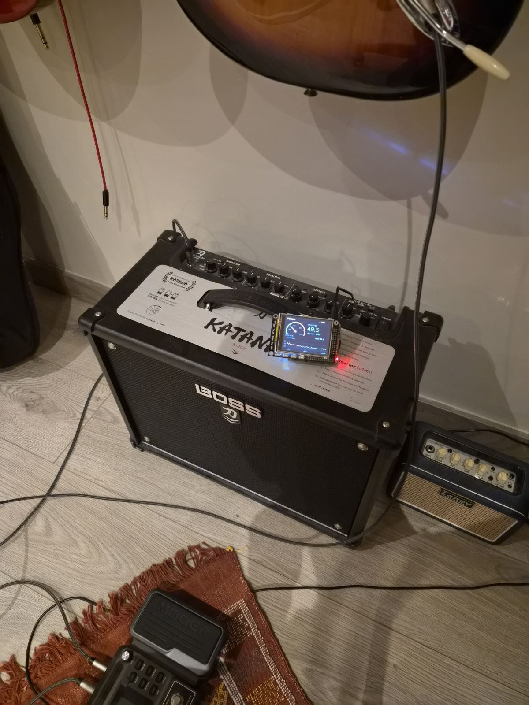
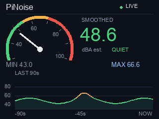
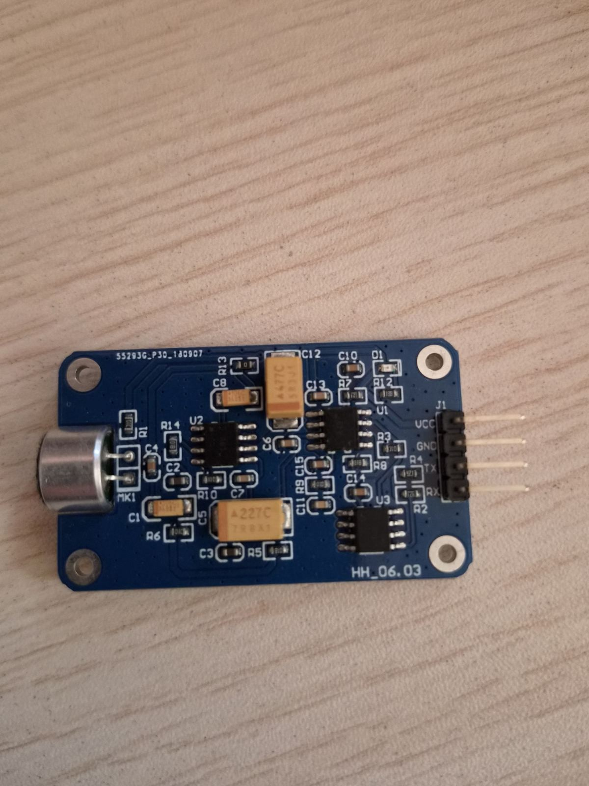
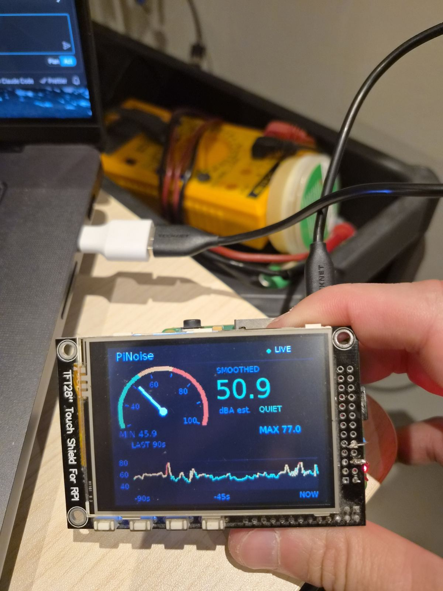
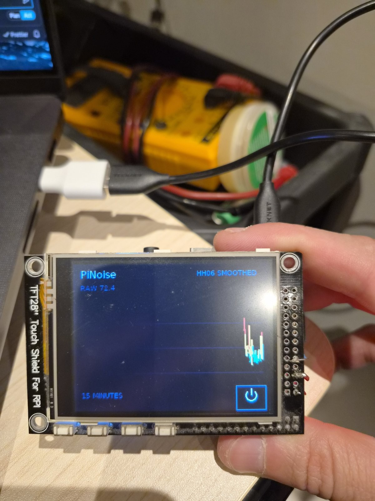
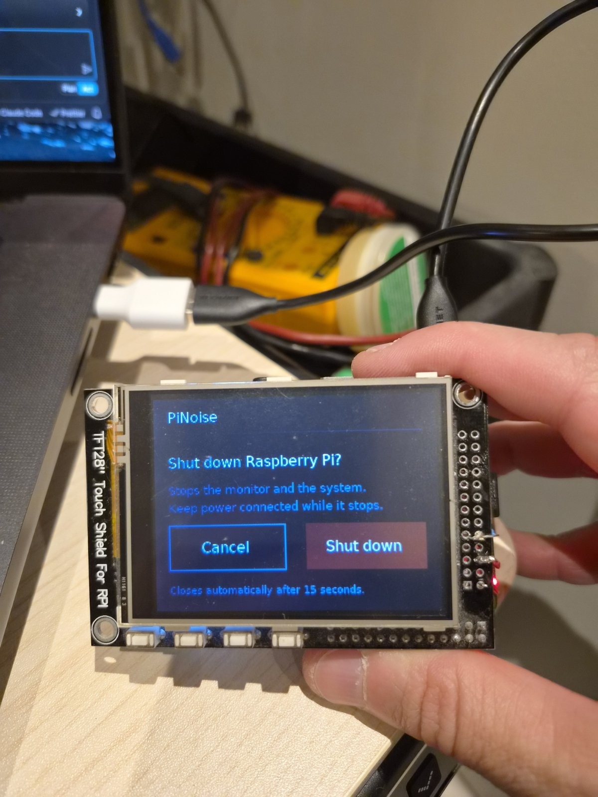

# PiNoise

A standalone **HH_06.03 sound-level dashboard** for a Raspberry Pi and a
320×240 ILI9341 SPI TFT. Reads the sensor locally over UART; no Mac, cloud
service, microphone recording or network connection is needed during use.





## Features

- Compact animated gauge and large numeric reading.
- Shaded 90-second history with a fixed 30–100 dB scale and matching MIN/MAX.
- A calmer **SMOOTHED** display: three-reading median followed by a 0.6-second
  exponential glide in dB. Sustained changes appear after approximately 0.5 s
  and settle over the next 1–2 s.
- LIVE/OFFLINE and below/above-range states; no stale current reading on outage.
- Optional touch-switchable 15-minute detail view with the unfiltered RAW value.
- A detail-screen power button with confirmation for graceful system shutdown.
- Read-only local telemetry containing original packets and module readings.
- Bounded buffers, exclusive UART ownership and automatic reconnect.

**Smoothing improves readability, not accuracy.** It may suppress genuine short
sounds. This is not an IEC Slow detector, certified SPL meter or hearing-safety
instrument. The module advertises A-weighting, 40–130 dB range and 0.1 dB
resolution; its accuracy and internal time response have not been independently
established. Do not interpret values below 40 dB as valid measurements. The
screen's dial/graph end at 100; valid higher readings remain visible numerically.

## Hardware

The deployed hardware is a Raspberry Pi Model A+ (ARMv6), Raspberry Pi OS,
and a 2.8-inch ILI9341/STMPE610 TFT configured as a 320×240 RGB565 framebuffer.
Other Pi models may work with an appropriately configured framebuffer and UART.

- HH_06.03 SPL module ([example listing on AliExpress](https://www.aliexpress.com/item/1005008553909463.html)); verify its supply and signal specifications for your board.
- ILI9341 TFT; STMPE610 touch is optional and requires a working Linux input driver.
- Level shifting appropriate to your module's TX voltage (see below).
- Suitable Pi power supply and microSD card.



### Wiring and electrical safety

Shut down and disconnect power before wiring. The example below assumes a module
with a 5 V supply and 5 V TX output; verify your board's documentation and voltage
first. Raspberry Pi GPIO is **not 5 V
tolerant**. Do not attach module TX directly to a GPIO input.

| Module | Pi |
|---|---|
| VCC | 5 V, physical pin 2 or 4 |
| GND | Ground, e.g. physical pin 6 |
| TX | Divider junction to GPIO15/RXD, physical pin 10 |
| RX | Leave disconnected |

```text
HH TX --- 1 kΩ ---+--- GPIO15 / RXD (physical pin 10)
                 |
                2 kΩ
                 |
HH GND ----------+--- Pi ground
```

This divider reduces a nominal 5 V signal to approximately 3.33 V. Verify voltage
and ground continuity before connecting it. Do not connect two transmitters to
RXD, or attach a second power source through a USB adapter. Do not connect a
powered sensor to an unpowered Pi. GPIO numbers are not physical pin numbers:
GPIO10 is an SPI signal, **not** UART RXD.

If the TFT covers the header, use correctly labelled GPIO breakout/pass-through
pads or a stacking header. Identify the exact board pinout first. The display
uses SPI; the sensor uses UART. Their signal connections must remain separate.

## Installation

Requires **Python 3.9+**, Pillow and pyserial. On Raspberry Pi OS, prefer the
OS packages for compatibility with older ARM CPUs:

```bash
sudo apt update
sudo apt install python3 python3-serial python3-pil fonts-dejavu-core
```

Enable UART hardware and disable the serial login shell with `sudo raspi-config`.
Remove any `console=serial0,...` or `console=ttyAMA0,...` argument from the boot
command line, preserving its single-line format. Reboot if configuration changed.
The application defaults to `/dev/ttyAMA0`, **115200 baud, 8N1**; override with
`--serial /dev/serial0` if appropriate for your Pi.

### Display setup

For the tested TFT clone, the boot configuration contains:

```ini
enable_uart=1
dtparam=spi=on
dtoverlay=fbtft,spi0-0,adafruit28,reset_pin=24,dc_pin=25,led_pin=18,rotate=90,speed=16000000
```

Use your display manufacturer's instructions rather than assuming this overlay
fits every board. Boot configuration is typically `/boot/config.txt` on older
systems or `/boot/firmware/config.txt` on newer ones. Back it up before editing.
The matching command-line file is in the same boot directory. Overlay support
varies with OS/kernel version; this project requires a Linux framebuffer device,
not merely an SPI device node.

Verify:

```bash
cat /sys/class/graphics/fb1/virtual_size
cat /sys/class/graphics/fb1/bits_per_pixel
```

Expected: `320,240` and `16`. Touch navigation works only if the touch controller
is configured to emit Linux touch input events. The main screen does not require it.

### Install and start the service

From the downloaded/cloned project directory, on the Pi:

```bash
sudo install -d /opt/pinoise
sudo cp -R pi /opt/pinoise/
sudo chown -R root:root /opt/pinoise
sudo chmod -R go-w /opt/pinoise
sudo install -m 644 pi/noise_gauge.service /etc/systemd/system/noise_gauge.service
sudo systemctl daemon-reload
sudo systemctl enable --now noise_gauge.service
systemctl status noise_gauge.service --no-pager
```

The unit uses root for framebuffer/UART/input access and restricts the telemetry
socket to root. It has no embedded login credentials. It is also sandboxed: the
filesystem is read-only apart from `/run/pinoise`, `/home` is hidden, there is no
network access, and kernel tunables/modules are protected. Device access is kept
because the gauge needs `/dev`. If you install under `/home` instead of
`/opt/pinoise`, use `ProtectHome=read-only` in an override. To use a different UART or
framebuffer, add an override with `sudo systemctl edit noise_gauge.service`:

```ini
[Service]
Environment=NOISE_SERIAL=/dev/serial0
Environment=NOISE_FB=/dev/fb1
```

Then restart the service. Before upgrading, save a copy of `/opt/pinoise` and the
unit file, stop the service, replace the application files, reload systemd and
start it again. Restore those copies if the upgrade fails.

For a manual test, **stop the service first** so there is only one UART owner:

```bash
sudo systemctl stop noise_gauge.service
sudo python3 /opt/pinoise/pi/noise_gauge.py --headless --duration 10
sudo systemctl start noise_gauge.service
```

## Display and data

### Measurement display





The main number, needle, graph and 90-second MIN/MAX represent the smoothed
visual trend. Colour zones (QUIET <55, MODERATE <70, LOUD ≥70) are UI categories,
not health or legal thresholds. LIVE means valid data is arriving, not that
accuracy has been certified. SENSOR OFFLINE appears after 1.5 seconds without a
valid measurement. History is in memory only and resets on restart.

For raw readings **without stopping the gauge**, run on the Pi:

```bash
sudo python3 /opt/pinoise/pi/capture.py --duration 30 > readings.jsonl
```

The Unix socket is `/run/pinoise/measurements.sock`. It is read-only and not
exposed over TCP. It sends a hello record, then measurement/health JSON records.
`reported_db` and `raw_hex` preserve the module output; `slow_db` is a renderer
compatibility field containing the same unsmoothed number (or null when invalid),
not a claim of Slow weighting. Telemetry `max_slow_db` is a four-second raw
maximum, distinct from the dashboard's 90-second smoothed maximum. Timestamps
are host monotonic receipt times, not sensor integration timestamps.

See [protocol documentation](docs/protocol.md) for packet decoding and limitations.

### Touch navigation and shutdown

Tap the dashboard to open the detail screen. Its bottom-right power icon opens
**“Shut down Raspberry Pi?”** with **Cancel** and **Shut down** buttons. Tapping
elsewhere on the detail screen returns to the dashboard. The main dashboard
layout is unchanged.



Confirmation requires a separate tap at least 0.75 seconds after the dialog
opens. Unconfirmed dialogs close after 15 seconds. Drags and rapid duplicate
touches are ignored. The application displays **“Shutting down…”** before
requesting normal systemd poweroff; systemd then stops the gauge and other
services. No forced shutdown or password prompt is used. On request failure,
an error screen offers **Back**, and measurements continue.

Keep power connected until system shutdown has completed. The last framebuffer
image may remain visible even after the CPU stops; it does **not** prove shutdown
is complete. Follow your Pi model's shutdown/activity indications. The screen
cannot switch the Pi back on: cycle power after shutdown, or use suitable
hardware wake/reset support.

#### Verify touch mapping before using shutdown

Framebuffer rotation does **not** necessarily rotate touch input. The reader
uses the kernel's ABS_X/ABS_Y ranges and BTN_TOUCH, selecting the first compatible
single-touch input device. It does not support multitouch-only devices. Default
rotation is zero; the tested TFT's physical mapping still needs verification.
If no compatible device is available, the monitor works without touch controls.

On the Pi, stop the gauge and run the harmless coordinate diagnostic from the
installed application directory. It only prints tap coordinates and cannot
request shutdown:

```bash
sudo systemctl stop noise_gauge.service
sudo env PYTHONPATH=/opt/pinoise/pi python3 -m pinoise.touch --duration 30
sudo systemctl start noise_gauge.service
```

Tap near the four corners. Expected screen coordinates are approximately
top-left `(0,0)`, top-right `(319,0)`, bottom-left `(0,239)` and bottom-right
`(319,239)`. Use `--touch-rotation 90` (or 180/270), `--touch-invert-x`,
`--touch-invert-y` and, if needed, `--touch-bounds XMIN XMAX YMIN YMAX` to match
the actual display. Inversions happen on raw axes before clockwise rotation.
`--touch-device /dev/input/event0` selects a specific device; prefer a stable
`/dev/input/by-path/` link where available. The diagnostic and gauge accept the
same touch options. A disconnected input is disabled until the gauge restarts.

If the STMPE610 is wired to SPI0 CS1 but there is no Linux input device, install
`python3-spidev` with apt and use `--touch-backend stmpe610` in both commands.
This optional adapter verifies chip ID `0x0811`, uses 12-bit coordinates and polls
the FIFO without enabling the interrupt pin. It accesses only `/dev/spidev0.1`;
the display remains on CS0. Do not enable a competing kernel touch driver or
another SPI reader on CS1. The standard PiTFT overlay may assign GPIO24 to the
touch interrupt, conflicting with this clone's display reset: do not replace a
working display overlay just to enable touch. No additional Python package is
required for the default evdev adapter or software tests.

On the tested clone, physical button taps were verified with:
`--touch-backend stmpe610 --touch-bounds 258 3820 191 3724 --touch-rotation 90`.
These are device-specific calibration values, not universal defaults. Check
at least three non-collinear targets: two opposite corners alone cannot
distinguish a rotated/swapped-axis mapping from an inverted axis. Verify both
the power icon and Cancel before attempting a real shutdown.

Once verified, put the same flags on the service's ExecStart using
`sudo systemctl edit noise_gauge.service`. For example, **only if your mapping
requires 90-degree rotation**:

```ini
[Service]
ExecStart=
ExecStart=/usr/bin/python3 /opt/pinoise/pi/noise_gauge.py --touch-rotation 90
```

Then run `sudo systemctl daemon-reload` and
`sudo systemctl restart noise_gauge.service`. The supplied root service can
request shutdown; a non-root installation needs appropriate systemd authorization.

## Troubleshooting

- **No readings:** confirm 5 V supply, common ground, TX → divider → Pi RXD,
  115200 baud, and serial console disabled. Do not attach another UART reader
  while the service runs. Inspect `sudo journalctl -u noise_gauge -n 50`.
- **Large spikes:** inspect RAW/telemetry and checksums. Valid packets can contain
  unstable measurements. Keep the board still and away from handling vibration,
  airflow and speaker contact; check supply stability. Compare against a reference
  meter at equal distance from the source before assuming a calibration offset.
- **White/blank TFT:** check overlay, display pin mapping, backlight and framebuffer
  format. The application intentionally refuses incompatible framebuffer geometry.
- **Touch does nothing:** check the touch driver and `/dev/input` devices.
- **Below range:** the specified minimum is 40 dB; the software does not invent
  measurements beneath it. A single out-of-range packet is treated as a spike
  and the smoothed trend is held, so a quiet room near 40 dB does not flicker;
  the detail screen shows `RAW BELOW RANGE`. Two or more in a row clear the
  number and break the graph.

## Development

On Linux or macOS (pseudo-terminal tests require POSIX):

```bash
python3 -m venv .venv
. .venv/bin/activate
python -m pip install -r requirements.txt
python -m unittest discover -s tests -v
```

Tests cover serial packet fragmentation/checksums, offline and range
handling, real pseudo-terminal acquisition, local telemetry, smoothing,
framebuffer colour encoding, dashboard layout, touch mapping and confirmed
shutdown. Poweroff commands are mocked in tests: tests never shut down the host.
They require neither physical
hardware nor network access. They verify software behaviour, not acoustic accuracy.

```text
pi/noise_gauge.py       Service entry point
pi/capture.py           Read-only telemetry client
pi/noise_gauge.service  systemd unit
pi/pinoise/hh0603.py    UART decoder, acquisition and module reading state
pi/pinoise/runtime.py   Local telemetry broker
pi/pinoise/presentation.py  Display-only smoothing
pi/pinoise/display.py   Dashboard, graph, framebuffer and shutdown dialog
pi/pinoise/touch.py     Coordinate mapping, tap input and safe diagnostic
pi/pinoise/stmpe610.py  Optional polled SPI0 CS1 touch adapter
pi/pinoise/controls.py  Navigation, confirmation and systemd shutdown request
tests/                Current regression tests
docs/                 Protocol, publication checklist and images
```

The dashboard image uses simulated data; it is not calibration evidence.

## Publication and licensing

No repository has been uploaded automatically. Review [the publication
checklist](docs/publishing.md) before pushing. A software license has not yet
been selected by the owner; public visibility alone does not grant an open-source
license. Add the license you intend to grant before inviting reuse.
